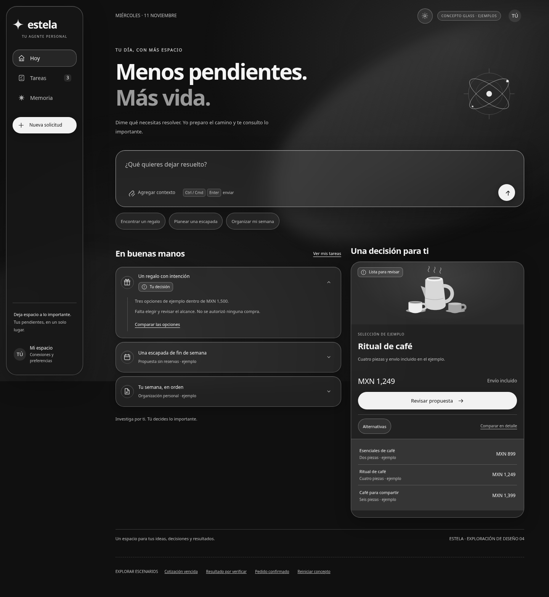

# AI-bot · agente personal para México

Roadmap, investigación y prototipo de experiencia para un asistente personal basado en Hermes.
**Estado: diseño y prototipo local con datos de ejemplo. La aplicación productiva todavía no está implementada.**

La dirección visual elegida es Liquid Glass monocromático, con apariencia grafito y plata.
“Estela” es un nombre de trabajo, sin validación de marca o dominio.

## Retomar el trabajo

1. Lee [el estado y los próximos pasos](docs/ESTADO.md).
2. Revisa [el roadmap completo de desarrollo y validación](docs/roadmap-desarrollo.md).
3. Abre [el prototipo](prototypes/estela/index.html) en un navegador; también puedes descargar el archivo y abrirlo localmente. No requiere API keys, npm ni servicios externos.
4. Para regenerarlo tras editar sus fuentes: `python3 prototypes/estela/build.py`.

## Documentos

| Documento | Contenido |
| --- | --- |
| [Roadmap en Markdown](docs/roadmap-desarrollo.md) · [PDF](docs/roadmap-desarrollo.pdf) | 24 semanas de referencia, fases, primeros diez días y pruebas visuales/funcionales. |
| [Arquitectura, costos y modelos](docs/arquitectura-costos-y-modelos.pdf) | Presupuesto para 25/100/1,000 usuarios, APIs y GPU, fuentes y supuestos. |
| [Experiencia, diseño y BeautifulUI](docs/experiencia-diseno-y-open-source.pdf) | Decisiones de UX, capturas, piezas reutilizables, licencias y adaptación. |
| [Referencias técnicas](docs/referencias/) | Hermes, competencia, código abierto, BeautifulUI y resultados de validación del concepto. |
| [Tokens visuales](docs/design-tokens.json) | Paleta/materiales del concepto; hay ajustes de BeautifulUI descritos en las referencias. |

## Arquitectura que debemos conservar

- Una **VM exclusiva y persistente por usuario** con Hermes, navegador, cookies, archivos y memoria propios. Un perfil o contenedor compartido no satisface ese requisito.
- Agenda y colas centrales para despertar VMs; cerrar la app no debe cancelar el trabajo.
- Identidad, permisos financieros, consentimiento y ledger **fuera de la VM**.
- PWA primero. Finco necesita identidad legal, contrato y documentación; no se equipara con Monato.
- Cobrar nuestro servicio, fondear la cuenta del usuario y pagar a un comercio son flujos diferentes.
- WhatsApp y pagos reales quedan condicionados a elegibilidad, contratos y pruebas.

## Prototipo

Puedes desplegar tareas, cambiar alternativas, revisar una autorización, simular un resultado pendiente y editar memoria de ejemplo. La actividad es local: no ejecuta Hermes, compras, búsquedas, reservas ni conexiones reales. Los datos se restablecen al recargar.

Las interacciones adaptadas de BeautifulUI conservan su aviso MIT. Los tipos Noto conservan sus avisos OFL. Consulta [los avisos](prototypes/estela/third_party/beautifului/NOTICE.txt) y [la licencia de fuentes](prototypes/estela/fonts/LICENSE.txt).
